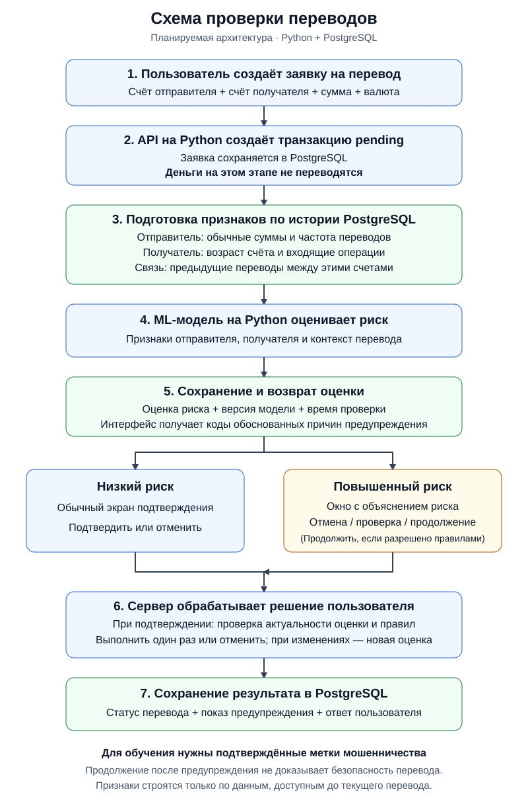

# VTB_antifraud
Данный репозиторий создан для участия в хакатоне MoscowCup

## Планируемая схема работы проекта

Схема ниже описывает планируемую архитектуру, а не уже реализованные возможности
репозитория. Python отвечает за API и оценку риска моделью машинного обучения,
а PostgreSQL хранит пользователей, счета, переводы и результаты проверок.

### Как это работает

1. **Создание заявки на перевод.** Пользователь указывает получателя, сумму и
   валюту. API на Python создаёт транзакцию со статусом `pending` — деньги на этом
   этапе ещё не переводятся.
2. **Подготовка признаков.** Из PostgreSQL берётся история, доступная до текущего
   перевода: обычные суммы и частота переводов отправителя, входящие операции
   получателя и предыдущие переводы между этими счетами.
3. **Оценка риска.** ML-модель анализирует все признаки вместе. Сохраняются оценка
   риска, версия модели, время проверки и причины предупреждения, подтверждённые
   данными.
4. **Подтверждение пользователем.** При низком риске показывается обычный экран
   подтверждения. Для подозрительного перевода появляется окно с объяснением:
   можно отменить перевод, проверить реквизиты или продолжить, если правила
   системы это допускают.
5. **Серверная проверка.** Перед выполнением сервер проверяет актуальность оценки
   для получателя и суммы, соблюдение правил системы и отсутствие повторного
   исполнения. При изменении реквизитов или суммы требуется новая оценка.
6. **Сохранение результата.** Записываются статус перевода и реакция пользователя
   на предупреждение. Подтверждённые результаты проверки на мошенничество можно
   позже использовать как метки для обучения. Продолжение после предупреждения
   не доказывает, что перевод безопасен.

### Данные и примечания к реализации

- `users` и `accounts` описывают владельцев счетов. Отправитель и получатель —
  роли, которые ссылаются на одну и ту же таблицу `accounts`.
- `transactions` хранит заявки на перевод и статусы их выполнения.
- `risk_assessments` хранит результаты модели, а `fraud_labels` —
  подтверждённые метки мошенничества отдельно от прогнозов.
- Для причин предупреждений и ответов пользователей нужно предусмотреть
  дополнительное хранение: в ранее обсуждавшейся базовой схеме этих полей нет.
- Чем выше оценка, тем выше предполагаемый риск. Однако оценка не обязательно
  является откалиброванной вероятностью мошенничества.
